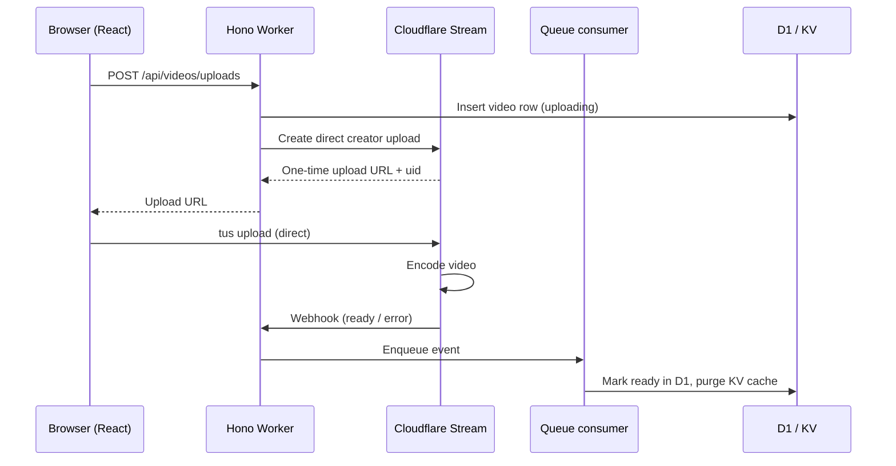

# YouTube clone MVP plan (Cloudflare, Hono, React)

Oct 28, 2026

## Goal and MVP scope

Ship a working video platform in 8 weeks where creators upload videos and viewers watch, like, comment and subscribe, running 100% on Cloudflare with Stream handling all video.

**In scope**

- Sign up, log in, log out (email + password, session cookie)
- Channel per user: name, handle, avatar
- Video upload direct to Stream, with title, description and visibility (public, unlisted)
- Video page with Stream player, view count, likes, comments
- Home feed (latest videos), channel page, basic title search
- Subscribe to channels and a subscriptions feed
- Creator studio: list own videos, edit metadata, delete

**Out of scope for MVP** (see post-MVP backlog)

- Live streaming, playlists, notifications, recommendations, monetization, private videos with signed URLs, moderation tooling, mobile apps

## Tech stack

One Worker serves both the React SPA (static assets) and the Hono API under `/api`, so there is one deploy, one domain and no CORS.

| Layer | Choice | Notes |
| --- | --- | --- |
| Language | TypeScript (strict) | Shared types between API and web via a `shared` package |
| Frontend | React + Vite | `@cloudflare/vite-plugin` runs the Worker inside Vite dev for local parity |
| Routing (web) | TanStack Router | File-based routes, typed params, Zod-validated search params, automatic code splitting |
| Data fetching | TanStack Query + Hono RPC client (`hc`) | End-to-end typed API calls, no codegen |
| Styling | Tailwind CSS + shadcn/ui | Fast, consistent UI primitives |
| Video player | Stream Player (iframe) or hls.js | Iframe for MVP; hls.js later for custom UI |
| Upload | tus-js-client | Resumable direct uploads to Stream |
| API | Hono on Workers | Middleware for auth, validation, errors |
| Validation | Zod + `@hono/zod-validator` | Same schemas used by forms on the web |
| ORM / migrations | Drizzle ORM + drizzle-kit (D1 driver) | Use `db.batch()` for atomic writes, never `db.transaction()` |
| Auth | Better Auth (D1 adapter) or hand-rolled sessions | Password hashing via Web Crypto (PBKDF2) |
| Video | Cloudflare Stream | Direct creator upload, webhook on ready |
| Database | D1 | Single database for MVP |
| Counters | Durable Objects | One object per video for views and likes |
| Cache | KV | Home feed and channel page cache |
| Async | Queues | Stream webhook events, counter flushes |
| Images | R2 + Images | Avatars and custom thumbnails |
| Bot protection | Turnstile | Sign-up, comment, upload |
| Observability | Sentry (`@sentry/cloudflare`, `@sentry/react`, `@sentry/vite-plugin`) | Errors, tracing, logs, metrics, replays on error; see Observability with Sentry |
| Testing | Vitest + `@cloudflare/vitest-pool-workers`, Playwright | Runs tests inside the Workers runtime |
| CI/CD | GitHub Actions + Wrangler | Preview per PR, deploy on merge, Sentry release + source map upload |

## Repository structure and setup

Use a pnpm workspace with one deployable app (Worker + SPA) and a shared package for types and Zod schemas.

```
vidflare/
├─ apps/
│  └─ web/
│     ├─ src/
│     │  ├─ client/            # React app (Vite)
│     │  │  ├─ routes/         # pages
│     │  │  ├─ components/
│     │  │  ├─ lib/api.ts      # hc<AppType> client
│     │  │  └─ main.tsx
│     │  └─ worker/            # Hono API
│     │     ├─ index.ts        # app, routes, queue + DO exports
│     │     ├─ routes/         # auth, videos, channels, comments, webhooks
│     │     ├─ middleware/     # session, rate limit, errors
│     │     ├─ db/schema.ts    # Drizzle schema
│     │     ├─ services/stream.ts
│     │     └─ do/VideoStats.ts
│     ├─ migrations/
│     ├─ vite.config.ts
│     └─ wrangler.jsonc
├─ packages/shared/             # zod schemas, DTO types
└─ .github/workflows/
```

**Setup steps**

1. `pnpm create cloudflare@latest web --framework=react` (Vite + Workers template), then add `hono`, `drizzle-orm`, `zod`, `@hono/zod-validator`.
2. In `vite.config.ts` add `cloudflare()` from `@cloudflare/vite-plugin` next to `react()`.
3. Create resources: `wrangler d1 create vidflare-db`, `wrangler kv namespace create CACHE`, `wrangler r2 bucket create vidflare-media`, `wrangler queues create stream-events`.
4. Enable Stream in the dashboard; create an API token with Stream:Edit; store `STREAM_ACCOUNT_ID`, `STREAM_API_TOKEN`, `STREAM_WEBHOOK_SECRET`, `TURNSTILE_SECRET`, `AUTH_SECRET` with `wrangler secret put`.
5. Configure the Stream webhook URL to `https://<domain>/api/webhooks/stream`.
6. Run `wrangler types` to generate the `Env` type used by `new Hono<{ Bindings: Env }>()`.

**`wrangler.jsonc` (essentials)**

```jsonc
{
  "name": "vidflare",
  "main": "src/worker/index.ts",
  "compatibility_date": "2026-10-01",
  "compatibility_flags": ["nodejs_compat"],
  "assets": { "not_found_handling": "single-page-application", "run_worker_first": ["/api/*"] },
  "d1_databases": [{ "binding": "DB", "database_name": "vidflare-db", "database_id": "<id>", "migrations_dir": "migrations" }],
  "kv_namespaces": [{ "binding": "CACHE", "id": "<id>" }],
  "r2_buckets": [{ "binding": "MEDIA", "bucket_name": "vidflare-media" }],
  "queues": {
    "producers": [{ "binding": "EVENTS", "queue": "stream-events" }],
    "consumers": [{ "queue": "stream-events", "max_batch_size": 10 }]
  },
  "durable_objects": { "bindings": [{ "name": "VIDEO_STATS", "class_name": "VideoStats" }] },
  "migrations": [{ "tag": "v1", "new_sqlite_classes": ["VideoStats"] }],
  "observability": { "enabled": true }
}
```

## Data model (D1)

Seven tables cover the MVP; video files live in Stream and D1 only stores the Stream UID and metadata. Counts on `videos` are denormalized and updated by the Durable Object flush, so feeds never run `COUNT(*)`.

| Table | Key columns | Notes |
| --- | --- | --- |
| `users` | id, email (unique), password_hash, created_at | Or Better Auth's `user` table |
| `sessions` | id, user_id, expires_at | HttpOnly cookie holds the session id |
| `channels` | id, user_id (unique), handle (unique), name, avatar_key, subscriber_count | One channel per user in MVP |
| `videos` | id, channel_id, stream_uid (unique), title, description, status, visibility, duration_s, thumbnail_url, view_count, like_count, comment_count, created_at, published_at | status: `uploading` → `processing` → `ready` → `error` |
| `likes` | user_id, video_id, created_at | PK (user_id, video_id) prevents double likes |
| `comments` | id, video_id, user_id, body, created_at, deleted_at | Flat comments; replies post-MVP |
| `subscriptions` | subscriber_id, channel_id, created_at | PK (subscriber_id, channel_id) |

**Indexes**

- `videos (status, visibility, published_at DESC)` for the home feed
- `videos (channel_id, published_at DESC)` for channel pages and the subscriptions feed
- `comments (video_id, created_at DESC)`
- `subscriptions (channel_id)` for subscriber lookups
- FTS5 virtual table `videos_fts (title, description)` for search, kept in sync by triggers; search results join back to `videos` and apply the public-listing filter

**Rules for D1**

- IDs are ULIDs or UUIDv7 (time-ordered, generated in the Worker).
- Timestamps are integer epoch milliseconds (D1 has no native date type).
- Multi-statement writes (e.g. insert comment + bump `comment_count`) go in one `db.batch()` so they commit atomically.
- Use cursor pagination on `(published_at, id)`, never `OFFSET`.
- Public listings (home feed, channel page, subscriptions feed, search) always filter `visibility = 'public' AND status = 'ready'`. Unlisted videos are reachable only by direct link and in the studio.
- Watch the 10 GB per database cap; at MVP scale one database is fine, and comments are the first table to move to its own database if needed.

## API design (Hono)

All routes live under `/api`, are validated with Zod, and are chained on one Hono app so the exported `AppType` gives the React client fully typed calls.

| Method | Route | Auth | Purpose |
| --- | --- | --- | --- |
| POST | `/api/auth/signup` | Turnstile | Create user + channel, start session |
| POST | `/api/auth/login` | — | Start session |
| POST | `/api/auth/logout` | User | End session |
| GET | `/api/me` | User | Current user and channel |
| GET | `/api/videos?cursor=` | — | Home feed (latest public, ready) |
| GET | `/api/videos/:id` | — | Video detail + channel + counts |
| POST | `/api/videos/uploads` | User | Create `videos` row + Stream direct upload URL |
| POST | `/api/videos/:id/uploaded` | Owner | Mark upload finished (`uploading` → `processing`) |
| PATCH | `/api/videos/:id` | Owner | Edit title, description, visibility |
| DELETE | `/api/videos/:id` | Owner | Delete in Stream + D1 |
| POST | `/api/videos/:id/view` | — | Record a view (to Durable Object) |
| PUT / DELETE | `/api/videos/:id/like` | User | Like / unlike |
| GET | `/api/videos/:id/comments?cursor=` | — | List comments |
| POST | `/api/videos/:id/comments` | User + Turnstile | Add comment |
| DELETE | `/api/comments/:id` | Owner | Soft-delete comment |
| GET | `/api/channels/:handle` | — | Channel info |
| GET | `/api/channels/:handle/videos?cursor=` | — | Channel videos (public, ready only) |
| PUT / DELETE | `/api/channels/:id/subscribe` | User | Subscribe / unsubscribe |
| GET | `/api/feed/subscriptions?cursor=` | User | Latest from subscribed channels |
| GET | `/api/search?q=` | — | FTS5 title/description search (public, ready only) |
| GET | `/api/studio/videos` | User | Creator's own videos, all statuses |
| POST | `/api/me/avatar` | User | Upload avatar to R2 |
| POST | `/api/webhooks/stream` | Signature | Stream "video ready / error" events |

**Middleware order:** Sentry instrumentation (outermost, via withSentry) → request id + logger → error handler (consistent JSON errors) → session loader (sets `c.var.user`) → `requireUser` on protected routes → Zod validators.

**Pattern for typed client**

```ts
// worker/index.ts
const app = new Hono<{ Bindings: Env; Variables: { user?: User } }>()
  .basePath('/api')
  .use(session())
  .route('/auth', auth)
  .route('/videos', videos)
  .route('/channels', channels)
  .route('/webhooks', webhooks)
export type AppType = typeof app
export default { fetch: app.fetch, queue: handleStreamEvents }
export { VideoStats } from './do/VideoStats'

// client/lib/api.ts
export const api = hc<AppType>('/')
// usage: const res = await api.api.videos[':id'].$get({ param: { id } })
```

## Key flows

Uploads go straight from the browser to Stream; the Worker only hands out a one-time URL and reacts to the webhook. Video bytes never pass through the Worker.



**Upload details**

1. `POST /api/videos/uploads` inserts a `videos` row with status `uploading`, then calls Stream's direct creator upload API with `maxDurationSeconds` and `meta.videoId`, and stores the returned `uid`.
2. The browser uploads with tus-js-client to the returned URL, then calls `POST /api/videos/:id/uploaded`, which sets status to `processing` only `WHERE status = 'uploading'`. This way a webhook that arrives first and sets `ready` is never overwritten.
3. `POST /api/webhooks/stream` verifies the `Webhook-Signature` HMAC, then enqueues the event; it returns 200 fast.
4. The queue consumer sets `ready` (or `error`), stores `duration_s` and `thumbnail_url`, sets `published_at`, and deletes the cached home feed and channel keys in KV.

**Playback**

- The watch page loads metadata from `/api/videos/:id` (served from KV cache for 60 s) and embeds the Stream player by `stream_uid`. Video segments are served by Stream's CDN, not the Worker.

**Views and likes**

1. The player posts `/api/videos/:id/view` after ~10 s of playback; the Worker forwards to the `VideoStats` Durable Object for that video.
2. The Durable Object dedupes by session id, increments counters in its own SQLite storage, and flushes totals to D1 every 60 s with an alarm.
3. Likes write the `likes` row and bump `like_count` in one `db.batch()`; `INSERT ... ON CONFLICT DO NOTHING` makes repeat likes harmless.

**Subscriptions**

- Subscribe and unsubscribe write or delete the `subscriptions` row and recompute `channels.subscriber_count = (SELECT COUNT(*) FROM subscriptions WHERE channel_id = ?)` in one `db.batch()`. Repeat requests are harmless, and the count can't drift. The `subscriptions (channel_id)` index keeps the count cheap. Users can't subscribe to their own channel.

**Auth**

- Sign-up verifies the Turnstile token, hashes the password with PBKDF2 (Web Crypto), and creates user + channel + session in one `db.batch()`. The session id goes in an HttpOnly, Secure, SameSite=Lax cookie.

## Frontend (React + Vite)

Nine routes cover the MVP; every page reads through TanStack Query hooks wrapping the typed Hono client, and route loaders prefetch with `queryClient.ensureQueryData` so data starts loading before the page renders.

| Route | Page | Main components |
| --- | --- | --- |
| `/` | Home feed | `VideoGrid`, `VideoCard`, infinite scroll |
| `/watch/:id` | Watch page | `StreamPlayer`, `LikeButton`, `SubscribeButton`, `CommentList`, `CommentForm` |
| `/c/:handle` | Channel | `ChannelHeader`, `VideoGrid` |
| `/feed/subscriptions` | Subscriptions | `VideoGrid` (auth required) |
| `/search?q=` | Search results | `SearchBar`, `VideoList` |
| `/upload` | Upload | `UploadDropzone` (tus), progress bar, metadata form |
| `/studio` | Creator studio | `StudioTable` with status badges, edit/delete |
| `/login`, `/signup` | Auth | `AuthForm`, `Turnstile` widget |
| `/settings` | Profile | Channel name, handle, avatar upload |

**Frontend guidelines**

- `StreamPlayer` wraps the Stream iframe (`https://customer-<code>.cloudflarestream.com/<uid>/iframe`) and posts a view to the API once playback passes ~10 seconds.
- Likes and subscribes use optimistic updates in TanStack Query, rolled back on error.
- The upload page polls `/api/studio/videos` (or the video endpoint) every few seconds until status becomes `ready`.
- Shared Zod schemas from `packages/shared` drive form validation (React Hook Form + zod resolver).
- Code-split routes; the watch page is the only one that loads the player.

## Milestones

The MVP ships in four two-week phases, each ending with a demo on the stage environment, leading to a public beta at the end of week 8.

| Phase | Weeks | Deliverables |
| --- | --- | --- |
| Foundation | 1–2 | Vite + Worker monorepo; D1 schema and migrations; auth and sessions; CI with preview URLs; Sentry |
| Upload and watch | 3–4 | Direct Stream upload; webhook and Queue; watch page and player; home feed and studio |
| Social | 5–6 | Likes and comments; view counter (Durable Object); channels and subscribe; subscriptions feed |
| Launch prep | 7–8 | Search (FTS5); KV cache and Turnstile; E2E tests and alerts; production deploy → **Public beta** |

```mermaid
gantt
    title MVP roadmap (8 weeks)
    dateFormat  X
    axisFormat  Week %s
    section Phases
    Foundation        :p1, 0, 2
    Upload and watch  :p2, after p1, 2
    Social            :p3, after p2, 2
    Launch prep       :p4, after p3, 2
    Public beta       :milestone, after p4, 0
```



**Exit criteria per phase**

- [ ] Foundation: a user can sign up and log in on a stage URL; CI deploys a preview per PR; a test error and its trace show up in Sentry for stage.
- [ ] Upload and watch: a 5-minute video uploads, turns `ready` via webhook, and plays on the watch page.
- [ ] Social: likes, comments, views and subscriptions work and counters stay correct after a DO flush.
- [ ] Launch prep: E2E suite green, Sentry alerts and dashboards in place, source maps resolving, production deployed behind your domain.

## Observability with Sentry

Sentry is the single place for errors, traces, logs and metrics across the React app, the Hono Worker, the queue consumer and the `VideoStats` Durable Object. One trace follows a request from a click in the browser through the Worker to D1 and the Stream API.

| Signal | Captured in | How |
| --- | --- | --- |
| Errors | Worker (routes, queue, Durable Object), React | Automatic via SDK wrappers; `Sentry.ErrorBoundary` in React; `captureException` in Hono's `onError` |
| Tracing | Browser → Worker → D1 / Stream / Queue | `browserTracingIntegration` + `tracePropagationTargets` for `/api`; automatic spans for requests, outbound fetch and D1; custom spans for Stream calls and queue jobs |
| Logs | Worker and React | `enableLogs: true` + `Sentry.logger.*`; every log line is linked to its trace |
| Metrics | Worker, Durable Object, React | `Sentry.metrics.count / gauge / distribution` (JS SDK 10.25+) |
| Session replay | React | Only on sessions with an error (`replaysOnErrorSampleRate: 1.0`) |
| Crons | Nightly reconcile job | `Sentry.withMonitor` around the scheduled handler |

**Worker setup**

- Install `@sentry/cloudflare`. The `nodejs_compat` flag already in `wrangler.jsonc` provides the `AsyncLocalStorage` the SDK needs.
- Wrap the exported handler with `Sentry.withSentry`; it instruments `fetch`, `queue` and `scheduled` handlers, and recent versions trace D1 queries automatically.
- Wrap the Durable Object class with `Sentry.instrumentDurableObjectWithSentry`.
- Sentry now also ships a standalone `@sentry/hono` package (middleware with route-pattern transaction names). Check the current Sentry docs at setup time and use either it or `withSentry` for the fetch path, not both initializing twice.
- A custom Hono `onError` handler swallows errors, so call `Sentry.captureException(err)` inside it before returning the JSON error.

```ts
// worker/sentry.ts
import * as Sentry from '@sentry/cloudflare'

export const sentryOptions = (env: Env) => ({
  dsn: env.SENTRY_DSN,
  environment: env.ENVIRONMENT,              // 'stage' | 'production'
  release: env.CF_VERSION_METADATA.id,       // ties errors to a Worker version
  tracesSampleRate: env.ENVIRONMENT === 'production' ? 0.2 : 1.0,
  enableLogs: true,
  sendDefaultPii: false,
})

// worker/index.ts
export default Sentry.withSentry(sentryOptions, {
  fetch: app.fetch,
  queue: handleStreamEvents,
  scheduled: reconcileVideos,
} satisfies ExportedHandler<Env>)

export const VideoStats = Sentry.instrumentDurableObjectWithSentry(sentryOptions, VideoStatsBase)

app.onError((err, c) => {
  Sentry.captureException(err)
  return c.json({ error: 'internal_error', requestId: c.get('requestId') }, 500)
})
```

**React setup**

```ts
// client/main.tsx
import * as Sentry from '@sentry/react'

Sentry.init({
  dsn: import.meta.env.VITE_SENTRY_DSN,
  environment: import.meta.env.MODE,
  release: import.meta.env.VITE_RELEASE,
  integrations: [
    Sentry.tanstackRouterBrowserTracingIntegration(router),  // route-pattern transaction names
    Sentry.replayIntegration({ maskAllText: true }),
  ],
  tracesSampleRate: 0.2,
  tracePropagationTargets: [/^\/api\//],  // continue traces into the Worker
  replaysSessionSampleRate: 0,
  replaysOnErrorSampleRate: 1.0,
  enableLogs: true,
})
```

- Wrap the app root in `Sentry.ErrorBoundary` with a friendly fallback page.
- On login call `Sentry.setUser({ id })`; on logout `Sentry.setUser(null)`. Never send email or passwords.

**Custom instrumentation**

- Spans: `Sentry.startSpan` around the Stream direct-upload call (`stream.create_upload`), each queue message (`queue.stream_event`, attribute `video.id`) and the Durable Object flush to D1 (`stats.flush`).
- Logs: `info` when a video becomes ready, `warn` on an invalid webhook signature, `error` when Stream reports an encoding error. Structured attributes only (ids, durations), no free-text PII.

| Metric | Type | Emitted in | Answers |
| --- | --- | --- | --- |
| `upload.started` | count | Worker | How many uploads begin |
| `upload.ready` / `upload.failed` | count | Queue consumer | Upload success rate |
| `video.processing_time` | distribution (ms) | Queue consumer | Time from upload to ready |
| `webhook.signature_invalid` | count | Worker | Spoofed or misconfigured webhooks |
| `video.view_recorded` | count | Durable Object | Views accepted after dedupe |
| `stats.flush_rows` | distribution | Durable Object | Flush size to D1 |
| `auth.login_failed` | count | Worker | Brute-force attempts |
| `upload.client_duration` | distribution (ms) | React | Upload time seen by creators |
| `player.start_time` | distribution (ms) | React | Time to first frame |

**Releases and source maps**

- Add `"version_metadata": { "binding": "CF_VERSION_METADATA" }` and an `ENVIRONMENT` var per environment to `wrangler.jsonc`; store `SENTRY_DSN` with `wrangler secret put`.
- Build with `build.sourcemap: 'hidden'` and add `@sentry/vite-plugin` to upload source maps for the client and Worker bundles in CI (needs `SENTRY_AUTH_TOKEN` as a CI secret only).
- Use the same release id in the Worker and the React build so a frontend error and its backend trace show under one release.

**Alerts and dashboards**

- Alerts: new issue in production; `/api` error rate above 2% for 5 min; p95 of `GET /api/videos/:id` above 500 ms; any `upload.failed` spike; `webhook.signature_invalid` above 0; missed check-in of the nightly cron.
- Dashboards: upload funnel (started → ready → failed), API latency p95 per route, queue processing time, views per hour.
- Privacy: scrub `Cookie` and `Authorization` headers in `beforeSend`, keep `sendDefaultPii: false`, mask text in replays.
- Workers Logs stays on as a free fallback for raw request logs.

## Testing, deployment, costs and risks

**Testing**

- Unit and route tests with Vitest in the Workers runtime (`@cloudflare/vitest-pool-workers`), using local D1, KV and Durable Objects.
- Mock the Stream API in tests; replay recorded webhook payloads to test the queue consumer.
- Playwright end-to-end: sign up → upload a short sample video → watch → like → comment, run against a stage Worker.

**Environments and deployment**

- `wrangler dev` / `vite dev` locally with local bindings; `remote: true` only for Stream calls.
- Two Cloudflare environments: `stage` and `production`, each with its own D1, KV, Queue and Stream webhook secret.
- GitHub Actions: typecheck + lint + tests on every PR, `wrangler versions upload` for a preview URL, `wrangler d1 migrations apply --remote` then `wrangler deploy` on merge to main.
- Alerting and dashboards run in Sentry (see Observability with Sentry); Workers Logs stays on as a fallback.

**Cost drivers** (check current pricing before launch)

- Workers Paid plan (base monthly fee) is required for Stream, Queues and Durable Objects.
- Stream bills minutes stored + minutes delivered; delivery dominates as viewers grow.
- D1, KV, Durable Objects and Queues are usage-based and small at MVP scale.
- Sentry plan: errors, spans, logs and replays are billed by volume; tune sample rates per environment.

**Risks and mitigations**

| Risk | Mitigation |
| --- | --- |
| Stream delivery cost grows with views | Set budget alerts; cap upload length (e.g. 15 min) and storage per creator |
| D1 10 GB cap and single-writer throughput | Keep hot counters in Durable Objects; plan a split of comments into its own D1 |
| No interactive transactions in D1 | Use `db.batch()` and conditional SQL (`ON CONFLICT`, `WHERE`) for invariants |
| Abuse: spam uploads, comments, fake views | Turnstile, rate limiting rules, one view per session per video in the DO |
| Webhook missed or delayed | Studio page can trigger a status re-check via the Stream API; nightly reconcile cron |
| Copyright or illegal uploads | Report button + manual takedown flow before public launch |

**Post-MVP backlog**

- Live streaming with Stream Live inputs and chat via Durable Objects + WebSockets
- Private videos with signed playback tokens
- Auto-captions and tags with Workers AI; semantic search and "related videos" with Vectorize
- Notifications for new uploads (Queues + email provider)
- Playlists, comment replies, watch history, Analytics Engine dashboards for creators
- Monetization with an external payment provider
